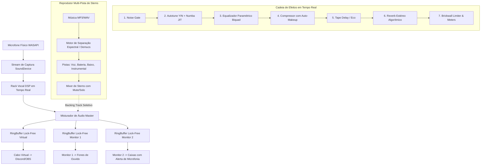

# Arquitetura Técnica e Engenharia de Áudio: VocalFlow Studio

Este documento detalha as decisões de engenharia, a cadeia de processamento de sinal digital (DSP), a concorrência multi-stream e os algoritmos de separação de fontes.

---

## 1. Visão Geral da Arquitetura

---

## 2. Pipeline Desacoplado Multi-Stream com Ring Buffers Lock-Free

Para alimentar múltiplos destinos de áudio simultâneos (Cabo Virtual e até dois Monitores Físicos) com latências e taxas de relógio de hardware distintas, adotamos uma arquitetura de **Pipeline Desacoplado**:

1. **Callback do Microfone (Produtor Único):**
   - O microfone captura blocos de áudio e alimenta a cadeia DSP **uma única vez**.
   - O áudio processado é somado ao *backing track* (se o usuário tiver habilitado o envio de stems para a respectiva saída).
   - O resultado é gravado de forma não bloqueante em 3 instâncias independentes de `AudioRingBuffer`.

2. **Callbacks de Saída (Consumidores Independentes):**
   - O Cabo Virtual (Discord/OBS), o Fone de Ouvido e as Caixas de Som puxam blocos do seu próprio `AudioRingBuffer`.
   - Se uma saída sofrer atraso ou for temporariamente desconectada, os outros dispositivos continuam operando normalmente sem estalos (*underruns*) nem descontinuidade na transmissão.

---

## 3. Motor de Autotune e Detecção de Pitch (Numba JIT)

A afinação em tempo real é baseada no algoritmo **YIN** com aceleração para código de máquina nativo via **Numba JIT**:

- **Detecção de Frequência Fundamental ($F_0$):**
  - Diferença quadrática de defasagem $\tau$.
  - Função Cumulativa Normalizada Média (CMNDF):
    $$d'_t(\tau) = \frac{d_t(\tau)}{\frac{1}{\tau} \sum_{j=1}^{\tau} d_t(j)}$$
  - Interpolação parabólica sub-amostra no primeiro mínimo local para precisão de centésimos de semitom.
- **Quantização Musical de Trap:**
  - Conversão para escala MIDI: $\text{midi} = 69 + 12 \log_2(F_0 / 440)$.
  - Projeção imediata para a nota permitida mais próxima na escala selecionada (ex: Pentatônica Menor de Hip-Hop).
  - O parâmetro `snap_speed = 0.0` gera a transição imediata (Hard Snap característico do Trap/Travis Scott), enquanto valores maiores introduzem inércia para correção natural.

---

## 4. Filtros Equalizadores Biquad IIR

O equalizador de 3 bandas utiliza equações do *Audio EQ Cookbook* de Robert Bristow-Johnson implementadas na forma direta transposta II (Direct Form II Transposed):
- **High-Pass (Corte < 80Hz):** Elimina ruídos subsônicos, batidas na mesa e ruídos mecânicos de pedestais de microfone.
- **Low-Shelf (120Hz):** Controle de peso e calor da voz (-12dB a +12dB).
- **Peaking Mid (2.5kHz, Q=1.0):** Ajuste fino de presença vocal e inteligibilidade das palavras e rimas no beat.
- **High-Shelf (9kHz):** Brilho de cápsula de condensador de estúdio ("Air").

---

## 5. Separação de Músicas e Extração de Stems

O aplicativo conta com uma estratégia híbrida:

1. **Motor Espectral Nativo (Zero Download):**
   - Utiliza Decomposição Harmônica-Percussiva (HPSS) e Decomposição Estéreo Central por STFT/ISTFT.
   - Extrai o canal central isolando a voz do instrumental, e segmenta frequências sub-graves (<220Hz) para isolar o baixo e transitórios temporais para a bateria.
   - Execução ultrarrápida (poucos segundos) em qualquer CPU sem exigir placas de vídeo dedicadas ou downloads de modelos pesados.

2. **Motor Neural Demucs (Meta AI Research):**
   - Suporte ao modelo `htdemucs` de 4 faixas (Voz, Bateria, Baixo, Outros) sob licença MIT.
   - Executado em thread secundária de baixa prioridade (`QThread`), garantindo que o processamento do microfone e a interface não sofram travamentos.

---

## 6. Sistema de Presets e Bloco de Letras

- **Presets:** Armazenados em formato JSON estruturado com chave `is_factory` protegendo os perfis clássicos contra exclusão acidental.
- **Letras:** Suporte a salvamento automático com *debounce* de 600ms, preservando cada barra e rima digitada sem exigir que o cantor pause o ensaio para salvar.
